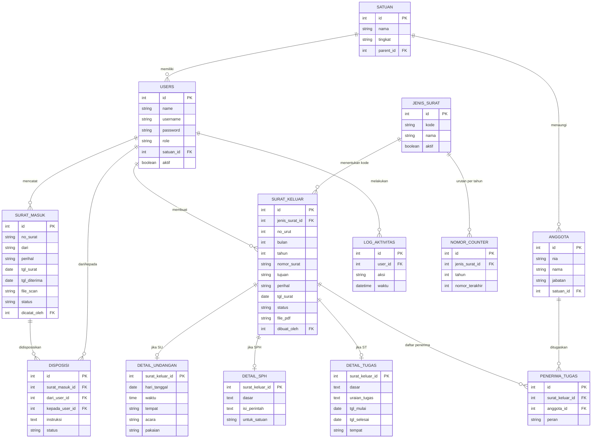

# SIGAP BANSER: Spesifikasi Proyek

Dokumen ini adalah bahan kerja untuk agen/IDE (Antigravity). Baca seluruhnya sebelum membuat kode.

**Nama aplikasi:** SIGAP BANSER (Sistem Informasi dan Administrasi Persuratan)
**Pemilik:** Adminpers BANSER Satkorcab Kab. Blitar
**Bahasa antarmuka:** Indonesia (kalimat biasa, bukan huruf kapital semua)

---

## 1. Tujuan
1. Mengelola **surat masuk** dan **surat keluar** secara digital, termasuk arsip dan penomoran otomatis.
2. Mengelola **data personal anggota** BANSER (tahap berikutnya, lihat bagian 12).
3. Menerbitkan nomor surat dengan format baku dan tanpa nomor ganda.

## 2. Tumpukan Teknologi
- Laravel 11+ (PHP 8.2+), MySQL 8
- Blade + Tailwind CSS (atau CSS biasa dengan token di bagian 8)
- Paket yang dianjurkan: `spatie/laravel-permission` (peran), `barryvdh/laravel-dompdf` (cetak PDF), `maatwebsite/excel` (ekspor), `simplesoftwareio/simple-qrcode` (QR)
- Hosting: VPS kecil atau cPanel dengan PHP 8.2+

## 3. Pengguna dan Peran

| Peran | Hak akses |
|---|---|
| `super_admin` | Semua fitur, manajemen pengguna, backup |
| `admin_adminpers` | Kelola surat masuk/keluar, anggota, template, laporan |
| `pimpinan` | Lihat, disposisi, setujui surat keluar (memicu penomoran) |
| `admin_satkoryon` | Input dan lihat data wilayahnya, ajukan surat |
| `anggota` | Lihat dan ubah profil sendiri |

Aturan: tombol **Setujui dan beri nomor** dapat diakses oleh verifikator (`super_admin`, `kasatkorcab`, `kasetma`, `pimpinan`, `admin_adminpers`).

## 4. Fitur Tahap 1 (MVP)

### A. Surat Masuk
Field wajib: **Nomor surat, Dari, Perihal**. Field tambahan: tanggal surat (opsional), tanggal diterima, scan surat (PDF/JPG/PNG, maks. 5 MB), status (`baru`, `didisposisi`, `selesai`), pencatat.
Fitur: tambah, daftar dengan pencarian (nomor, pengirim, perihal), lihat detail, unduh scan, disposisi ke pimpinan.

### B. Surat Keluar
Jenis surat (tabel `jenis_surat`, mudah ditambah):

| Kode | Nama |
|---|---|
| `SU` | Surat Undangan |
| `SPH` | Surat Perintah Harian |
| `ST` | Surat Tugas / Mandat |
| `SK` | Surat Keputusan |

Alur status: `draf` → `verifikasi` → `disetujui` → `terkirim`.
Setiap jenis punya isian khusus (tabel detail):
- **SU:** hari/tanggal acara, waktu, tempat, acara, pakaian
- **SPH (Surat Perintah Harian):** dasar, untuk satuan, jumlah personel, hari/tanggal kegiatan, waktu, acara, tempat, pakaian, catatan
- **ST:** dasar, uraian tugas, tanggal mulai, tanggal selesai, tempat, daftar penerima tugas (anggota)
- **SK (Surat Keputusan):** tentang, konsiderans menimbang, konsiderans mengingat, konsiderans memperhatikan, diktum keputusan (pertama s/d kelima), lampiran SK susunan personil, tembusan, tempat/tanggal penetapan Masehi dan Hijriyah (dengan KOP Surat resmi sama persis dengan SPH).

### Lembar Disposisi Surat Masuk
Pada modul Surat Masuk bagian cetak, tersedia formulir cetak resmi **Lembar Disposisi** dengan KOP Surat sama persis dengan SPH, tabel data registrasi surat masuk, kotak sifat surat, checklist tujuan disposisi pimpinan Satkorcab, checklist petunjuk/instruksi, kotak catatan tambahan pimpinan, dan tanda tangan pimpinan/stempel resmi.

### Modul Struktur Organisasi Satkorcab
Terletak di sidebar tepat setelah **Profil Organisasi**, memuat 17 unit hierarki komando Banser Satkorcab Kab. Blitar:
1. **KASATKORCAB** (Kepala Satuan Koordinasi Cabang)
2. **WAKASATKORCAB** (Wakil Kepala Satkorcab, dinamis: dapat ditambah dan dikurangi sesuai kebutuhan)
3. **KASETMA** (Kepala Sekretariat Markas)
4. **7 Biro Markas:** Biro Adminpers, Biro Asrendiklat, Biro Kegiatan, Biro Informasi & Komunikasi, Biro Kerjasama, Biro Penelitian & Pengembangan, Biro Logistik. *(Dapat diedit nama Ketua & daftar Anggota).*
5. **7 Satuan Khusus (SATSUS):** SATSUS PROVOST, SATSUS PROTOKOLER, SATSUS BAGANA, SATSUS BASADA, SATSUS BALANTAS, SATSUS BARITIM, SATSUS BALAKAR. *(Dapat diedit nama Ketua/Komandan, Wakil Ketua/Komandan, & daftar Anggota).*
Fitur: Bagan visual hierarki, modal edit cepat per unit, formulir edit massal terpadu, penambahan/penghapusan baris wakil secara dinamis, dan cetak bagan organisasi.

### C. Kode / Nomor Surat

**Format:** `000/SKC-<KODE JENIS>/<BULAN ROMAWI>/<TAHUN>`

| Bagian | Sumber | Contoh |
|---|---|---|
| `000` | urutan, diisi nol hingga 3 digit | `007` |
| `SKC` | tetap (Satkorcab) | `SKC` |
| `<KODE JENIS>` | `jenis_surat.kode` | `SU`, `SPH`, `ST` |
| Bulan Romawi | dari tanggal surat | `X` |
| Tahun | dari tanggal surat | `2026` |

Contoh: `001/SKC-SU/X/2026`, `002/SKC-ST/X/2026`.

Aturan penomoran:
1. Urutan dihitung **per jenis surat per tahun** (asumsi; bisa diubah menjadi satu urutan bersama dengan satu baris counter tanpa `jenis_surat_id`).
2. Nomor dibuat **saat surat disetujui**, bukan saat draf, agar tidak ada nomor yang terlewat.
3. Proses dalam satu transaksi database dengan `lockForUpdate()` agar tidak ada nomor ganda.
4. `nomor_surat` bersifat `UNIQUE`; `no_urut`, `bulan`, `tahun` disimpan terpisah untuk rekap.
5. Surat yang sudah bernomor tidak boleh diberi nomor lagi.

## 5. Diagram ERD



## 6. Skema SQL (acuan; di Laravel dibuat lewat migrasi)

```sql
CREATE TABLE satuan (
  id INT AUTO_INCREMENT PRIMARY KEY,
  nama VARCHAR(100) NOT NULL,
  tingkat ENUM('Satkorcab','Satkoryon','Satkorkec','Satkordes') NOT NULL,
  parent_id INT NULL,
  FOREIGN KEY (parent_id) REFERENCES satuan(id)
);

-- Tabel users bawaan Laravel + kolom: username (unik), role, satuan_id, aktif

CREATE TABLE anggota (
  id INT AUTO_INCREMENT PRIMARY KEY,
  nia VARCHAR(30) UNIQUE,
  nama VARCHAR(100) NOT NULL,
  jabatan VARCHAR(100),
  satuan_id INT NULL,
  FOREIGN KEY (satuan_id) REFERENCES satuan(id)
);

CREATE TABLE surat_masuk (
  id INT AUTO_INCREMENT PRIMARY KEY,
  no_surat VARCHAR(100) NOT NULL,
  dari VARCHAR(150) NOT NULL,
  perihal VARCHAR(255) NOT NULL,
  tgl_surat DATE NULL,
  tgl_diterima DATE NOT NULL,
  file_scan VARCHAR(255) NULL,
  status ENUM('baru','didisposisi','selesai') DEFAULT 'baru',
  dicatat_oleh INT NOT NULL,
  created_at TIMESTAMP DEFAULT CURRENT_TIMESTAMP,
  FOREIGN KEY (dicatat_oleh) REFERENCES users(id)
);

CREATE TABLE disposisi (
  id INT AUTO_INCREMENT PRIMARY KEY,
  surat_masuk_id INT NOT NULL,
  dari_user_id INT NOT NULL,
  kepada_user_id INT NOT NULL,
  instruksi TEXT,
  status ENUM('diproses','selesai') DEFAULT 'diproses',
  created_at TIMESTAMP DEFAULT CURRENT_TIMESTAMP,
  FOREIGN KEY (surat_masuk_id) REFERENCES surat_masuk(id),
  FOREIGN KEY (dari_user_id) REFERENCES users(id),
  FOREIGN KEY (kepada_user_id) REFERENCES users(id)
);

CREATE TABLE jenis_surat (
  id INT AUTO_INCREMENT PRIMARY KEY,
  kode VARCHAR(10) NOT NULL UNIQUE,
  nama VARCHAR(100) NOT NULL,
  aktif TINYINT(1) DEFAULT 1
);
INSERT INTO jenis_surat (kode, nama) VALUES
 ('SU','Surat Undangan'),('SPH','Surat Perintah Harian'),('ST','Surat Tugas / Mandat');

CREATE TABLE nomor_counter (
  id INT AUTO_INCREMENT PRIMARY KEY,
  jenis_surat_id INT NOT NULL,
  tahun SMALLINT NOT NULL,
  nomor_terakhir INT NOT NULL DEFAULT 0,
  UNIQUE KEY uq_jenis_tahun (jenis_surat_id, tahun),
  FOREIGN KEY (jenis_surat_id) REFERENCES jenis_surat(id)
);

CREATE TABLE surat_keluar (
  id INT AUTO_INCREMENT PRIMARY KEY,
  jenis_surat_id INT NOT NULL,
  no_urut INT NULL,
  bulan TINYINT NULL,
  tahun SMALLINT NULL,
  nomor_surat VARCHAR(60) NULL UNIQUE,
  tujuan VARCHAR(150),
  perihal VARCHAR(255) NOT NULL,
  tgl_surat DATE NOT NULL,
  status ENUM('draf','verifikasi','disetujui','terkirim') DEFAULT 'draf',
  file_pdf VARCHAR(255) NULL,
  dibuat_oleh INT NOT NULL,
  created_at TIMESTAMP DEFAULT CURRENT_TIMESTAMP,
  FOREIGN KEY (jenis_surat_id) REFERENCES jenis_surat(id),
  FOREIGN KEY (dibuat_oleh) REFERENCES users(id)
);

CREATE TABLE detail_undangan (
  surat_keluar_id INT PRIMARY KEY,
  hari_tanggal DATE NOT NULL, waktu TIME, tempat VARCHAR(200),
  acara VARCHAR(200), pakaian VARCHAR(100),
  FOREIGN KEY (surat_keluar_id) REFERENCES surat_keluar(id) ON DELETE CASCADE
);
CREATE TABLE detail_sph (
  surat_keluar_id INT PRIMARY KEY,
  dasar TEXT, isi_perintah TEXT NOT NULL, untuk_satuan VARCHAR(150),
  FOREIGN KEY (surat_keluar_id) REFERENCES surat_keluar(id) ON DELETE CASCADE
);
CREATE TABLE detail_tugas (
  surat_keluar_id INT PRIMARY KEY,
  dasar TEXT, uraian_tugas TEXT NOT NULL,
  tgl_mulai DATE, tgl_selesai DATE, tempat VARCHAR(200),
  FOREIGN KEY (surat_keluar_id) REFERENCES surat_keluar(id) ON DELETE CASCADE
);
CREATE TABLE penerima_tugas (
  id INT AUTO_INCREMENT PRIMARY KEY,
  surat_keluar_id INT NOT NULL, anggota_id INT NOT NULL, peran VARCHAR(100),
  FOREIGN KEY (surat_keluar_id) REFERENCES surat_keluar(id) ON DELETE CASCADE,
  FOREIGN KEY (anggota_id) REFERENCES anggota(id)
);
CREATE TABLE log_aktivitas (
  id BIGINT AUTO_INCREMENT PRIMARY KEY,
  user_id INT NOT NULL, aksi VARCHAR(255) NOT NULL,
  waktu TIMESTAMP DEFAULT CURRENT_TIMESTAMP,
  FOREIGN KEY (user_id) REFERENCES users(id)
);
```

## 7. Kode Inti: Layanan Penomoran (Laravel)

`app/Services/NomorSuratService.php`

```php
<?php

namespace App\Services;

use App\Models\NomorCounter;
use App\Models\SuratKeluar;
use Carbon\Carbon;
use Illuminate\Support\Facades\DB;

class NomorSuratService
{
    private const ROMAWI = [
        1 => 'I', 2 => 'II', 3 => 'III', 4 => 'IV', 5 => 'V', 6 => 'VI',
        7 => 'VII', 8 => 'VIII', 9 => 'IX', 10 => 'X', 11 => 'XI', 12 => 'XII',
    ];

    public function terbitkan(SuratKeluar $surat): SuratKeluar
    {
        return DB::transaction(function () use ($surat) {
            $surat = SuratKeluar::with('jenis')->whereKey($surat->id)->lockForUpdate()->firstOrFail();

            if ($surat->nomor_surat) {
                return $surat; // sudah bernomor
            }

            $tgl = Carbon::parse($surat->tgl_surat);

            NomorCounter::firstOrCreate(
                ['jenis_surat_id' => $surat->jenis_surat_id, 'tahun' => $tgl->year],
                ['nomor_terakhir' => 0]
            );

            $counter = NomorCounter::where('jenis_surat_id', $surat->jenis_surat_id)
                ->where('tahun', $tgl->year)->lockForUpdate()->first();

            $counter->increment('nomor_terakhir');

            $surat->update([
                'no_urut'     => $counter->nomor_terakhir,
                'bulan'       => $tgl->month,
                'tahun'       => $tgl->year,
                'nomor_surat' => sprintf('%03d/SKC-%s/%s/%d',
                    $counter->nomor_terakhir, $surat->jenis->kode,
                    self::ROMAWI[$tgl->month], $tgl->year),
                'status'      => 'disetujui',
            ]);

            return $surat->refresh();
        });
    }
}
```

Aturan validasi simpan surat keluar (di controller, berdasarkan `jenis.kode`):
- Umum: `jenis_surat_id` wajib ada, `perihal` wajib, `tgl_surat` wajib tanggal.
- `SU`: `hari_tanggal` wajib. `SPH`: `isi_perintah` wajib. `ST`: `uraian_tugas` wajib, `penerima` array minimal 1 (`exists:anggota,id`), `tgl_selesai >= tgl_mulai`.
- Simpan induk dan detail dalam satu `DB::transaction`.

Route yang dibutuhkan:
```
GET  surat-masuk                      → SuratMasukController@index
POST surat-masuk                      → SuratMasukController@store
POST surat-keluar                     → SuratKeluarController@store
POST surat-keluar/{id}/setujui        → SuratKeluarController@setujui   (hanya pimpinan, admin_adminpers)
```

## 8. Desain Antarmuka

Gunakan **dua logo** yang disediakan (letakkan di `public/images/`):
- `Banser.png` → logo BANSER (merah, kuning, segitiga Ansor hijau). Ukuran tampil kecil, sekitar 64 px, di header dan favicon.
- `LOGO_ADMIN_rev_2.png` → logo Adminpers Kab. Blitar (sayap emas, perisai merah-putih). Tampil besar di header dan halaman login. Latar logo transparan.

Semboyan pada logo Adminpers dipakai di footer: *"Rapi di meja, solid di laga: satu data, satu komando!"*

**Token warna**

| Token | Nilai | Pemakaian |
|---|---|---|
| `--hero1` / `--hero2` | `#5A0E14` / `#240608` | latar header dan kotak nomor surat |
| `--red` | `#E5232B` | status baru, penanda tab aktif, kartu "menunggu disposisi" |
| `--yellow` | `#F5EB0F` | angka nomor surat, catatan |
| `--gold` | `#C9A24A` | tombol persetujuan, garis aksen, semboyan |
| `--green` | `#0E9B4A` | status selesai |
| `--accent` | `#8E1B22` (terang) / `#D12A31` (gelap) | tombol utama |
| `--bg` / `--surface` | `#F3F2F0` / `#FFFFFF` | latar halaman / panel (mode terang) |
| mode gelap | `--bg #150E0F`, `--surface #201516`, `--ink #F2E9E7` | ikuti `prefers-color-scheme` |

**Tipografi:** judul `Archivo` (700 sampai 900), isi `Public Sans` (400 sampai 600). Sediakan fallback `system-ui`.

**Tata letak**
1. **Header:** gradien marun gelap dengan bayangan emas halus di belakang logo Adminpers. Kiri: logo BANSER kecil, judul "SIGAP BANSER", subjudul "Sistem informasi dan administrasi persuratan Satkorcab Kab. Blitar". Kanan: logo Adminpers besar. Di dasar header ada garis 6 px tiga warna: merah, kuning, hijau.
2. **Tab menu** di bawah header: Beranda, Surat masuk, Surat keluar (tab aktif bergaris bawah merah 4 px).
3. **Beranda:** satu baris tiga angka ringkasan (surat masuk bulan ini, menunggu disposisi [latar merah], surat keluar bulan ini); lalu dua panel: "Perlu tindakan" dan "Nomor terakhir terbit" per jenis.
4. **Surat masuk:** panel form (nomor surat, dari, perihal, tanggal surat, tanggal diterima, unggah scan), lalu tabel daftar dengan kolom pencarian.
5. **Surat keluar:** pilihan jenis (SU/SPH/ST) berbentuk tombol pilihan; kotak **nomor contoh** bergradasi marun dengan angka kuning, berubah sesuai jenis dan tanggal; isian umum; isian khusus per jenis; tombol *Simpan draf*, *Ajukan ke pimpinan*, *Setujui dan beri nomor* (emas).
6. **Footer** marun gelap berisi semboyan.

**Aturan tampilan:** responsif sampai layar HP (grid satu kolom, tabel bergulir ke samping), fokus keyboard terlihat, kontras teks cukup, tombol memakai kata kerja ("Simpan surat masuk", bukan "Submit"), pesan kesalahan menyebut apa yang salah dan cara memperbaikinya.

## 9. Keamanan
- Kata sandi di-hash (bawaan Laravel), batasi percobaan login, wajib HTTPS.
- Upload hanya PDF/JPG/PNG maks. 5 MB; simpan di storage privat, bukan folder publik.
- Hak akses per peran; `admin_satkoryon` hanya melihat data satuannya.
- Catat aksi penting ke `log_aktivitas` (buat, ubah, setujui, hapus).
- Backup basis data terjadwal.
- Data personal anggota (tahap 2): tampilkan NIK/alamat hanya ke peran berwenang dan sediakan kebijakan privasi sederhana (UU PDP).

## 10. Struktur Berkas yang Diharapkan

```
app/
  Http/Controllers/SuratMasukController.php
  Http/Controllers/SuratKeluarController.php
  Models/{Satuan,Anggota,JenisSurat,NomorCounter,SuratMasuk,Disposisi,
          SuratKeluar,DetailUndangan,DetailSph,DetailTugas,PenerimaTugas}.php
  Services/NomorSuratService.php
database/
  migrations/ (satuan+users+anggota+jenis_surat+nomor_counter, surat_masuk+disposisi,
               surat_keluar+detail+penerima+log)
  seeders/JenisSuratSeeder.php
resources/views/ (layout, beranda, surat-masuk, surat-keluar)
public/images/{Banser.png, LOGO_ADMIN_rev_2.png}
routes/web.php
```

## 11. Tugas untuk Agen (urutan kerja)

- [ ] 1. Buat proyek Laravel, atur `.env` MySQL, pasang Breeze (login) dan `spatie/laravel-permission`.
- [ ] 2. Tulis migrasi sesuai bagian 5 dan 6, jalankan, dan buat `JenisSuratSeeder` (SU, SPH, ST).
- [ ] 3. Buat model beserta relasinya.
- [ ] 4. Implementasikan `NomorSuratService` (bagian 7) dan **tulis uji otomatis**: format nomor benar, urutan naik per jenis, urutan mulai dari 001 saat tahun berganti, dua permintaan bersamaan tidak menghasilkan nomor sama, surat bernomor tidak diberi nomor lagi.
- [ ] 5. Buat layout Blade dengan header, tab, dan footer sesuai bagian 8 (pasang kedua logo).
- [ ] 6. Surat masuk: form, validasi, unggah scan, daftar, pencarian.
- [ ] 7. Surat keluar: pilihan jenis, isian khusus per jenis, simpan draf, ajukan, setujui (memanggil layanan penomoran), pembatasan peran.
- [ ] 8. Beranda: angka ringkasan dan daftar "Perlu tindakan".
- [ ] 9. Cetak surat keluar ke PDF dengan kop surat Satkorcab dan nomor surat.
- [ ] 10. Disposisi surat masuk dan log aktivitas.
- [ ] 11. Uji di HP dan mode gelap; periksa keamanan upload dan hak akses.

## 12. Tahap 2 (setelah MVP)
- **Data anggota:** biodata (NIA, NIK, TTL, alamat, HP, golongan darah, pendidikan, pekerjaan, foto), keorganisasian (satuan, jabatan, status), diklat dan kepangkatan, unggah dokumen, impor/ekspor Excel.
- **KTA digital** dengan QR verifikasi dan logo BANSER.
- Notifikasi WhatsApp untuk surat/disposisi baru, tanda tangan digital + QR keaslian surat.

## 13. Hal yang Masih Perlu Dikonfirmasi
1. Urutan nomor per jenis per tahun, atau satu urutan untuk semua jenis?
2. Kolom detail SU/SPH/ST: samakan dengan contoh surat asli Satkorcab (kop, bagian "Menimbang/Mengingat/Memerintahkan", dan lain-lain).
3. Siapa saja yang boleh menyetujui surat dan menerbitkan nomor.
4. Apakah Satkoryon/Satkorkec ikut memakai aplikasi pada tahap 1.
